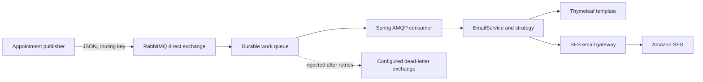

# bAppoint Email Service

The bAppoint Email Service is a Spring Boot application that consumes transactional email requests from RabbitMQ, renders an HTML appointment-confirmation template, and asks Amazon Simple Email Service (Amazon SES) to send it. It is an asynchronous worker, not an HTTP email API.

## What it does

The service separates appointment-event publishing from email rendering and delivery. A publisher sends a JSON message to a RabbitMQ direct exchange; the service consumes it, selects an email strategy by enum key, renders a Thymeleaf template, and calls SES.

Implemented capabilities:

- Consumes JSON messages from a configured RabbitMQ queue.
- Declares a durable direct exchange, a durable work queue, and a binding.
- Configures listener retries and a dead-letter exchange on the work queue.
- Renders an appointment-confirmation HTML template with Thymeleaf.
- Sends HTML email through the AWS SDK for Java and Amazon SES.

Only `APPOINTMENT_CONFIRMATION` has an email strategy today. Other values in the `EmailKey` enum do not have implementations.

## Technology

| Technology | Role |
|---|---|
| Java 25, Spring Boot 4.1.1 | Runtime, dependency injection, configuration, and application startup |
| Spring AMQP / RabbitMQ | Asynchronous message consumption and broker topology declarations |
| Jackson JSON message converter | Converts RabbitMQ JSON payloads to `EmailDto` |
| Thymeleaf | Renders the appointment-confirmation HTML template |
| AWS SDK for Java / Amazon SES | Submits rendered messages to SES |
| PostgreSQL, Spring Data JPA | Database driver and configured datasource; no email persistence code is present |
| Maven Wrapper | Reproducible Maven build entry point |

## Architecture



The service declares the work exchange, queue, and work binding. It declares a dead-letter exchange and configures the work queue to route rejected messages to it, but it does **not** declare or bind the configured dead-letter queue. See [architecture](docs/architecture.md) and [error handling](docs/error-handling.md).

## Prerequisites

- Java 25.
- A RabbitMQ broker reachable by the application.
- Amazon SES configured for the account and region used by the service, with a verified sender.
- PostgreSQL for the configured datasource. `compose.yaml` starts a local PostgreSQL container only.
- Docker only if building/running the provided image.

## Quick start

1. Review [configuration](docs/configuration.md) and set credentials in your environment or secret manager. Do not commit secrets. The checked-in configuration currently contains hard-coded RabbitMQ and AWS credentials; treat them as exposed and rotate them before use.
2. Start the local database:

   ```sh
   docker compose up -d postgres
   ```

3. Set the required RabbitMQ and AWS environment configuration for the application. Connect it to a reachable broker and SES account; no RabbitMQ container is provided by Compose.
4. Build and test:

   ```sh
   ./mvnw clean test
   ```

5. Run:

   ```sh
   ./mvnw spring-boot:run
   ```

The configured web-server port is `8081`. There is no business HTTP API or health endpoint; Springdoc exposes generated API documentation endpoints (`/v3/api-docs` and `/swagger-ui.html`) by default. Startup also depends on external infrastructure and usable configuration. For a message example, see [message contract](docs/message-contract.md).

## Minimal message example

Publish to the configured exchange using the configured routing key and JSON content type. The enum value must be the exact string `APPOINTMENT_CONFIRMATION`.

```json
{
  "userId": "c8bcb8e5-7419-4e17-84b6-bf4b1ced3034",
  "userName": "Alex Example",
  "key": "APPOINTMENT_CONFIRMATION",
  "emailFrom": "appointments@example.invalid",
  "emailTo": "alex@example.invalid",
  "appointmentDate": "2026-10-25",
  "appointmentTime": "14:30",
  "companyName": "Example Studio",
  "serviceName": "Consultation"
}
```

The publisher does not receive an application-level delivery receipt. A broker publish is not proof that SES accepted or delivered the email. Current SES exception handling can suppress failures; review [error handling](docs/error-handling.md) before relying on this service operationally.

## Build, test, and package

```sh
./mvnw test
./mvnw package
```

The repository includes one Spring context-load test; it is not a full integration test and requires the context's external configuration to be satisfiable. Docker packaging requires a built JAR first:

```sh
./mvnw package
docker build -t bappoint-email-service .
```

The Dockerfile exposes port `3030`, while the application configuration uses `8081`; correct the deployment port mapping or align these settings before relying on the image. See [deployment](docs/deployment.md).

## Documentation

- [Architecture](docs/architecture.md)
- [Message contract and publisher integration](docs/message-contract.md)
- [Getting started](docs/getting-started.md)
- [Configuration reference](docs/configuration.md)
- [Errors, retries, and dead-letter behavior](docs/error-handling.md)
- [Deployment](docs/deployment.md)
- [Operations and troubleshooting](docs/operations.md)
- [Security](docs/security.md)
- [Development and contribution](docs/development.md)
- [Architecture decisions and limitations](docs/decisions.md)

## Status and known limitations

This repository provides an initial worker implementation, not a production-complete email platform. There is no HTTP API, publisher implementation, formal message validation, persistence/audit trail, idempotency mechanism, configured DLQ binding, health/metrics endpoint, CI workflow, or automated end-to-end messaging test. SES `SesException`s are logged and suppressed. See the linked documentation for exact behavior and operational implications.
