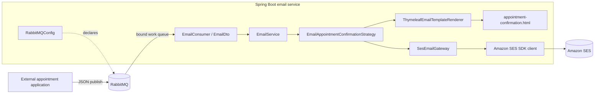
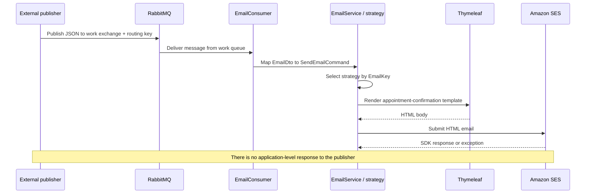
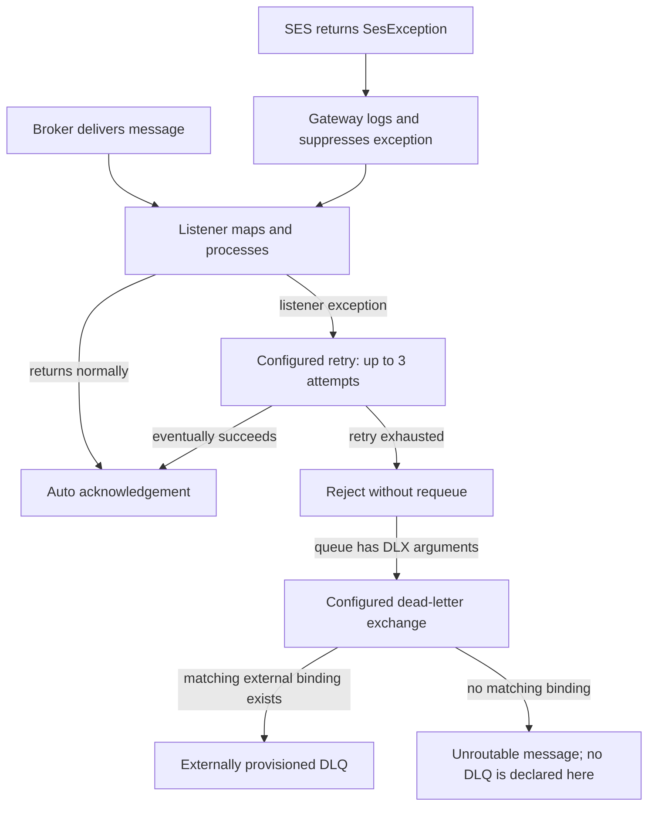

# Architecture

## Scope

The application is a Spring Boot RabbitMQ consumer. An external application publishes appointment email requests; this repository contains no producer. The worker converts a message into an application command, selects an email strategy, renders HTML with Thymeleaf, and submits it to Amazon SES.

## Components

`EmailGateway` and `EmailTemplateRenderer` are application ports. `SesEmailGateway` and `ThymeleafEmailTemplateRenderer` are their adapters. The startup class is `BappointEmailServiceApplication`.

## RabbitMQ topology

Topology is declared by `RabbitMQConfig` using Spring AMQP beans. Names come from `app.rabbitmq.*` in `application.yaml`.

| Element | Current behavior |
|---|---|
| Work exchange | Durable direct exchange; default configured name is `emailExchange` |
| Work queue | Durable queue; default configured name is `emailQueue` |
| Work routing key | Default `email.send` |
| Work binding | The configured work queue is bound to the configured direct exchange with the work routing key |
| Dead-letter exchange (DLX) | Durable direct exchange; default configured name is `email.dlx` |
| Dead-letter routing key | Default `email.failed`, attached to the work queue as its dead-letter routing key |
| Dead-letter queue (DLQ) | A name (`email.dlq`) exists in configuration, but no queue or binding bean uses it |

The broker can route dead-lettered messages only to a queue bound to the DLX with a matching routing key. Since this application does not declare that queue/binding, DLQ delivery requires external broker provisioning. Without a matching binding, the rejected message may be discarded as unroutable.

The producer must publish to the work exchange and routing key, not directly to the queue. The producer needs permission to publish; this application/broker identity needs permission to declare or access the configured topology and consume from the queue.

## End-to-end message flow

`EmailService` supports strategy lookup using `EmailKey`, but only the appointment confirmation strategy is registered. `EmailAppointmentConfirmationStrategy` passes `userName`, `appointmentDate`, `appointmentTime`, `companyName`, and `serviceName` to the template renderer. `EmailDto.emailFrom` is not used; the SES sender is configured separately as `aws.ses.from`. The template also references `year`, but the strategy does not provide it.

## Failure flow

Listener retry/rejection behavior is detailed in [error handling](error-handling.md). Importantly, `SesEmailGateway` catches `SesException`, logs it, and returns normally. The listener therefore sees no exception for that SES failure and may acknowledge the message. A successful SDK request is not proof of final inbox delivery.

## Design characteristics and trade-offs

- **Asynchronous decoupling:** the appointment publisher does not call SES synchronously. This allows queue-based buffering, but no producer receipt or end-to-end delivery status is implemented.
- **Broker-based scaling:** multiple consumers can be deployed against the same queue, but processing order is not guaranteed across concurrent consumers and duplicate effects are possible.
- **Strategy/template separation:** a strategy builds email content, the renderer resolves a named template, and the gateway submits it. The extension point exists, but additional strategies and formal contract validation are absent.
- **Failure isolation is incomplete:** listener retries exist, but SES service exceptions are swallowed. The configured dead-letter route has no queue binding in the repository.
- **Persistence is not part of the email flow:** PostgreSQL/JPA configuration and dependencies exist, but no email entity or repository is present. There is no durable processing audit maintained by the application.

## External dependencies

| Dependency | Purpose | Repository support |
|---|---|---|
| RabbitMQ | Request transport and listener queue | Connection properties and topology beans are configured; broker deployment is external |
| Amazon SES | Outbound HTML email | SDK client and gateway implemented |
| PostgreSQL | Configured Spring datasource | Compose starts PostgreSQL; email persistence is not implemented |

No business HTTP endpoints, health checks, metrics, or application-specific exception handlers are implemented. The Springdoc dependency exposes generated `/v3/api-docs` and `/swagger-ui.html` endpoints by default, even though there are no application controllers.
